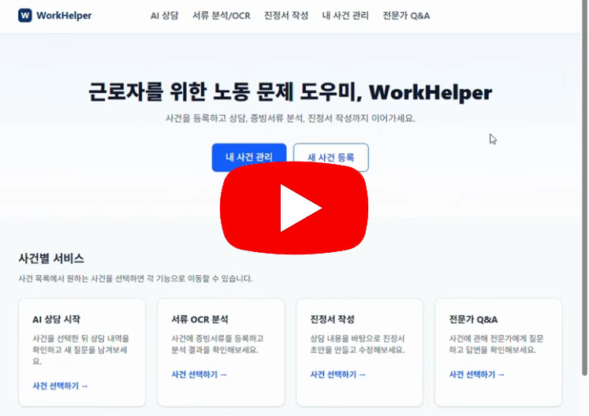
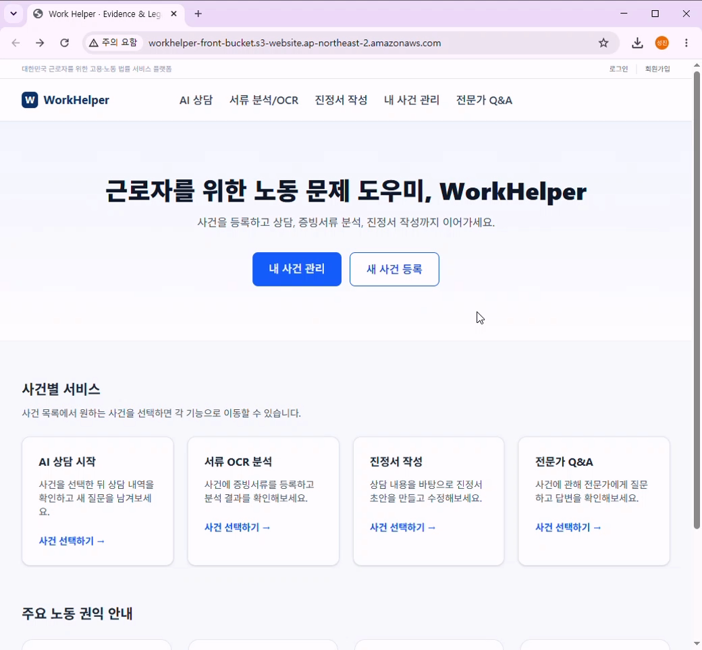
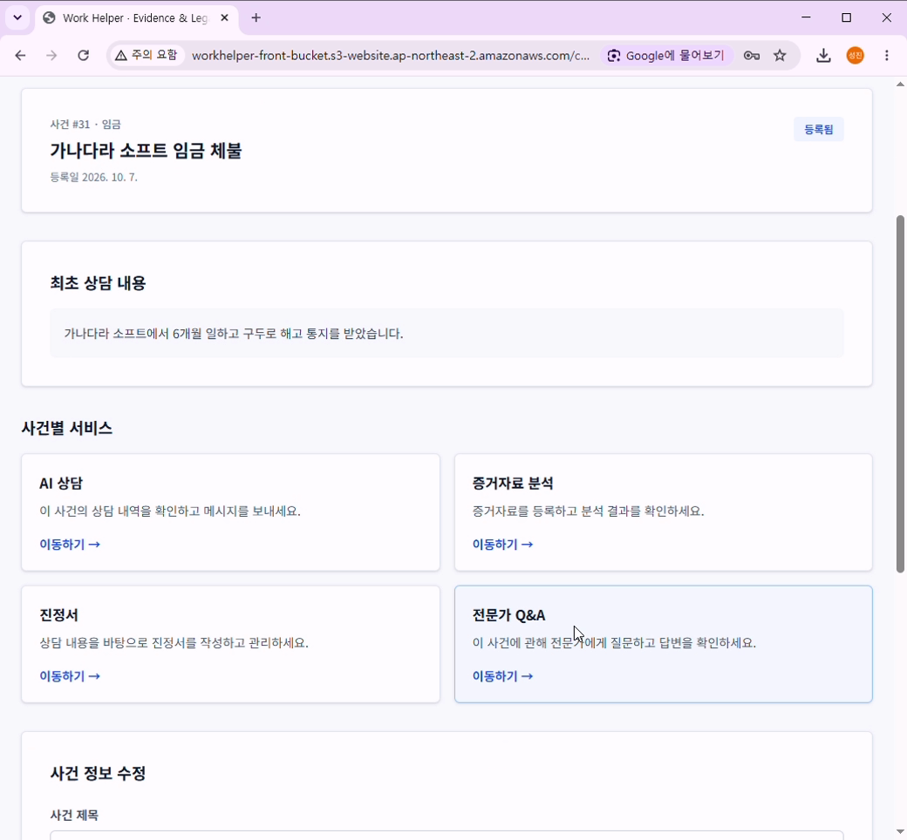
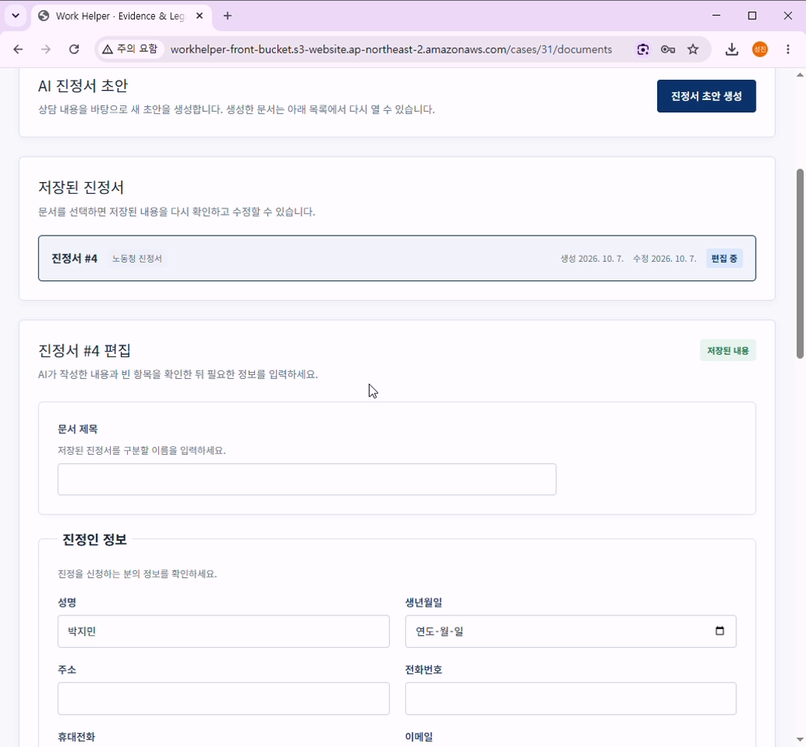
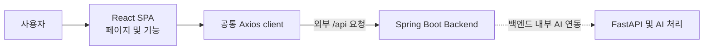

# WorkHelper Frontend

[](https://nodejs.org/)
[](https://react.dev/)
[](https://www.typescriptlang.org/)
[](https://vite.dev/)

## 프로젝트 개요

WorkHelper Frontend는 노동 문제를 겪는 사용자를 위한 React SPA입니다. 사용자가 사건을 관리하고, 사건별 상담과 증거 분석을 진행하며, 진정서를 작성하고 전문가에게 질문할 수 있는 화면을 제공합니다.

## 팀 구성 및 역할 분담

| 담당자 | 구분 | 역할 |
| --- | --- | --- |
| 박성진(PM) | AI 서버 | 내부 API, OCR, LLM 워크플로우 및 RAG 개발, AI 서버 CI/CD, AI 서버 버전 관리 |
| 권순현(PL) | AI 서버 | 법령·판례 수집, 파싱, 임베딩 및 DB 적재, RAG, AI 채팅상담 개발, 백엔드 CI/CD |
| 이규원(AA) | 프론트/백 | DB 설계 및 구축, 외부 API 연동, 내부 AI API 연동, 프론트엔드/백엔드 버전 관리 |
| 홍동연 | 프론트/백 | AI 채팅상담 화면구현, 사건목록 화면구현, 화면 UI 구현 |
| 홍은지 | 프론트/백 | 로그인 및 회원가입 화면구현, JWT + Redis Session 기반 인증 세션 구현, React Router 기반 라우팅 제어 |
| 홍은영 | 프론트/백 | 전문가 QnA 화면구현, JWT 기반 사용자 권한별 분기 처리, S3 파일 업로드 로직 구현, 통합 테스트 |

## 시연 영상 및 서비스 화면

### 시연 영상
[](https://youtu.be/jGwFLN5WKLM)

### 서비스 화면

| 메인화면 | 로그인 화면 | 사건 관리 화면 |
| :---: | :---: | :---: |
|  |  |  |

| AI 채팅 상담 화면 | 증거 서류 분석 화면 | 진정서 작성 초안 화면 |
| :---: | :---: | :---: |
|  |  |  |

## 주요 기능

- 회원가입 및 로그인
- 사건 목록, 생성 및 상세 관리
- 사건별 AI 상담
- 사건 증거 등록 및 분석 화면
- 진정서 작성 및 PDF 출력
- 전문가 질문 및 답변
- 관리자 전문가 신청 심사

## 기술 스택

| 구분 | 기술 |
| --- | --- |
| Runtime | Node.js 22.23.2 |
| UI | React 18.3.x |
| Language | TypeScript 5.x |
| Build tool | Vite 6.x |
| Routing | React Router 6.x |
| HTTP client | Axios 1.x |
| State management | Zustand 5.x |

## 서비스 아키텍처



Frontend는 Spring Boot의 외부 `/api`만 호출합니다. Spring Boot와 FastAPI 간의 `/internal/ai/*` 계약, AI 처리, RAG, OCR/Vision 처리는 백엔드 영역이며 이 저장소에서 직접 호출하거나 구현하지 않습니다.

## 프로젝트 디렉토리 구조

```text
src/
├─ app/          # Application root와 중앙 Router
├─ pages/        # Route 단위 화면 조합
├─ features/     # 도메인별 API, 컴포넌트, 타입, 상태
│  ├─ admin/
│  ├─ auth/
│  ├─ cases/
│  ├─ consultation/
│  ├─ documents/
│  ├─ evidence/
│  ├─ expert/
│  └─ favorites/
└─ shared/       # 공통 API client, 레이아웃, 유틸리티
```

## 실행 방법

### 요구 사항

- Node.js `22.23.2` 이상, `23` 미만
- Spring Boot Backend

### 설치 및 실행

```bash
npm install
npm run dev
```

### 검사 및 빌드

```bash
npm run lint
npm run build
```

### 환경 변수

| 변수명 | 설명 | 예시 |
| --- | --- | --- |
| `VITE_API_BASE_URL` | Spring Boot Backend origin | `http://localhost:8080` |

API 함수는 `/api/...` 경로를 사용하므로 `VITE_API_BASE_URL`에는 `/api`를 포함하지 않습니다.